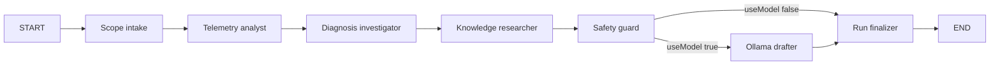

# LangGraph agent architecture

The customer operations workflow uses `@langchain/langgraph` as a request-scoped orchestration layer. It coordinates deterministic application functions, bounded public-reference retrieval, workflow policy, and an optional Ollama communication draft.

## Runtime graph

The implementation is in `apps/support-console/lib/agent-graph.ts`. Both `POST /api/investigate` and `POST /api/agents/run` call the same graph, so the workbench and case investigations use identical orchestration.

## Shared state

The graph state includes the case and authorization scope; synthetic fixture and product; deterministic result, evidence, hypotheses, and next step; up to three scored public references; optional validated Ollama output; workflow risk and authorization state; and an append-only node trace with status, duration, and detail.

## Node contracts

1. **Scope intake** loads a known case and verifies tenant and account access.
2. **Telemetry analyst** calculates weighted rates and rejects invalid or overflowing counters.
3. **Diagnosis investigator** evaluates client regression, credential failure, and regional degradation. It resolves only when one cause is supported.
4. **Knowledge researcher** performs bounded retrieval across versioned public sources. References provide context and do not prove causality.
5. **Safety guard** classifies the proposed diagnostic request or engineering handoff. The public demo has no authenticated actor, so persistence is denied.
6. **Ollama drafter** runs conditionally after safety checks. It enforces a strict schema and timeout and safely falls back on any failure.
7. **Run finalizer** returns the evidence, citations, action decision, model state, and trace.

## Frontend and APIs

The **Agent graph** workspace provides case selection, explicit Ollama opt-in, node completion and timing, an ordered trace, final diagnosis, action policy, evidence, and retrieval panels. The case investigation dialog also renders the trace returned by this graph.

- `GET /api/agents/run` returns graph metadata and topology.
- `POST /api/agents/run` accepts `{ "caseId": "CS-1042", "useModel": false }` and returns topology plus the complete graph result.
- `POST /api/investigate` accepts the same input for the case dialog.

## Persistence and human approval

The prototype compiles without a checkpointer. This keeps serverless requests isolated and avoids presenting in-memory checkpoints as durable state.

For production:

1. Add `@langchain/langgraph-checkpoint-postgres` using a dedicated database role and schema.
2. Use the investigation-run UUID as `configurable.thread_id`.
3. Persist checkpoints within the same tenant boundary as the case.
4. Add `interrupt()` only immediately before an authorized write.
5. Store an approval digest with tenant, actor, action type, exact payload, expiry, and resource version.
6. Resume with `Command({ resume: ... })` and the same thread ID.
7. Revalidate scope, role, expiry, digest, and resource state before committing.
8. Write the business change and audit event in one transaction.

Do not put customer secrets, Supabase service keys, or the Ollama API key in graph state, checkpoints, prompts, traces, or browser responses.

## Tests

`tests/agent-graph.test.mjs` verifies the resolved path, abstention path, exact node sequence, action boundary, retrieval, and tenant rejection. Run it with the full suite using `npm test` or `npm run validate`.
